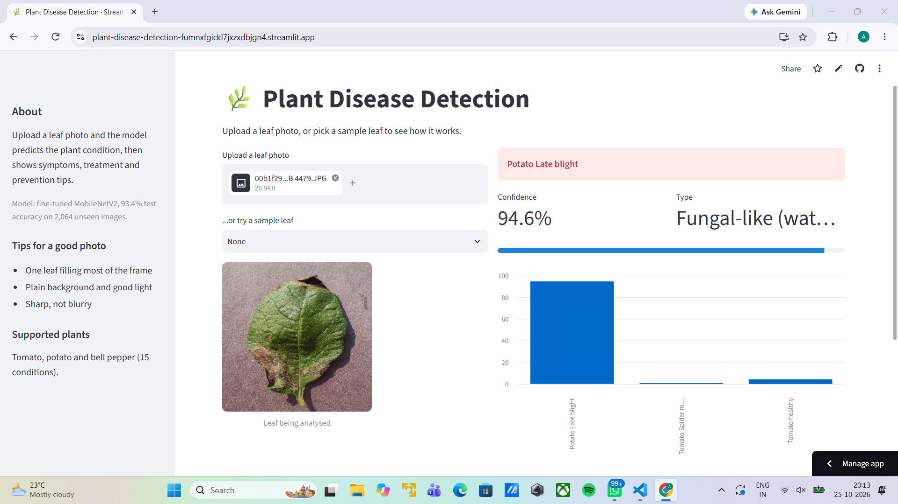

# Plant Disease Detection

Classifies plant leaf photos into 15 classes (healthy and diseased pepper, potato and tomato leaves) with a fine-tuned MobileNetV2, and serves predictions through a Streamlit web app.

**Live demo:** https://plant-disease-detection-fumnxfgickl7jxzxdbjgn4.streamlit.app/

## Results

| Model | Validation accuracy |
|---|---|
| Baseline CNN (from scratch) | 82% |
| MobileNetV2, frozen base | 90% |
| MobileNetV2, fine-tuned | 93% |

Final test accuracy: **93.4%** (macro F1 0.92) on 2,064 images never used in training.

- Strongest classes: Pepper bell healthy and Tomato Yellow Leaf Curl Virus (F1 0.99).
- Weakest class: Tomato Early blight (recall 0.60), likely confused with similar tomato leaf spots.

## Dataset

PlantVillage from Kaggle (arjuntejaswi/plant-village): 15 classes, 20,639 images. One unreadable image was removed. The data is split 80/10/10 into train, validation and test sets, stratified so rare classes appear in every split. The images are not included in this repository.

## Project structure

- notebooks/01_data_exploration.ipynb: class counts, imbalance, sample images
- notebooks/02_preprocessing.ipynb: stratified split and data augmentation
- notebooks/03_baseline_cnn.ipynb: small CNN trained from scratch
- notebooks/04_transfer_learning.ipynb: MobileNetV2 transfer learning, fine-tuning, test evaluation
- src/data.py: shared data loading (filters unreadable images)
- app/app.py: Streamlit app

## Run locally

    pip install -r requirements.txt
    streamlit run app/app.py

## Limitations

The model is trained on PlantVillage photos, which show a single leaf on a plain background. Accuracy on real field photos will be lower.
